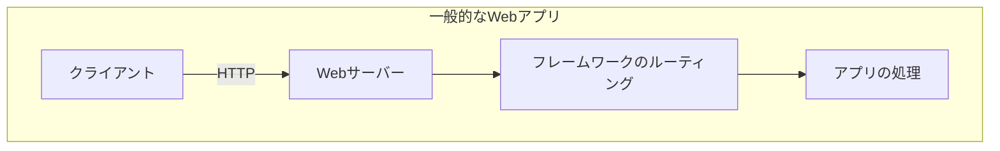
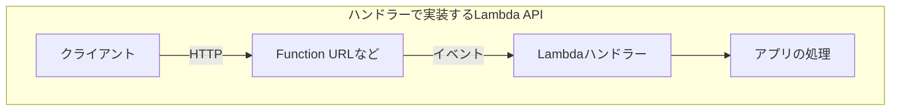
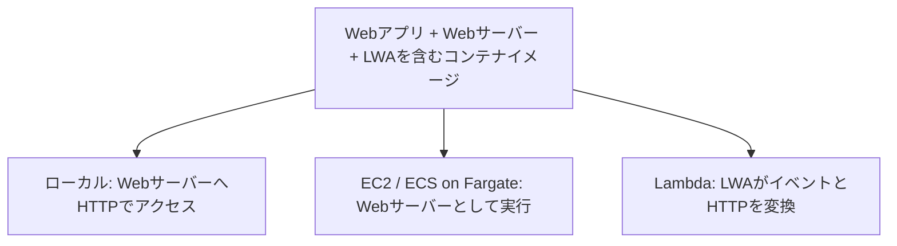

:::message warning
本記事の執筆中に[Lambda Web Functions](https://aws.amazon.com/blogs/aws/announcing-aws-lambda-web-functions-for-fast-consistent-web-app-performance-anywhere/)が登場しました！！！
発表時点ではNode.jsが対象なので、今回は予定どおりPython / FastAPIとLWAの話です。以降のLambdaの説明は、従来のイベントを受け取る関数（Event Functions）を前提にしています。
:::


## はじめに

**Webアプリを作ったので、AWSにデプロイしたい。** 
そんなとき、まず思い浮かぶのはEC2やECS/Fargateではないでしょうか。

ただ、EC2を使うなら、アプリだけでなくOSのアップデートなど、サーバーのメンテナンスも必要です。
ECS/Fargateならサーバー管理の手間は減りますが、今度はタスク定義やサービス、ネットワークなどの設定を用意する必要があります。

作ったアプリを動かしたいだけなのに、デプロイするまでにも意外とやることがあります。もう少し手軽に動かす方法はないでしょうか。

そこで気になるのがLambdaです。サーバーを用意せずに動かせるので、こういう小さなアプリにはよさそうです。
ただ、普段のWebフレームワークで書いたアプリを持っていっても、そのままではLambdaの呼び出しを受け取れません。ハンドラーを書いたり、アダプターを組み込んだりする必要があります。デプロイを楽にしたいのに、アプリ側の作業も増えるのは少し悩ましいですね。

この間をつないでくれるのが、**AWS Lambda Web Adapter（以下、LWA）** です。通常のWebアプリを、Lambda固有のハンドラーを書かずに動かせるとのことなので、今回はFastAPIで作ったAPIをデプロイしてみました。


## 成果物

今回作成したのは、50件の格言からランダムに1件を返すAPIです。CloudFront経由で、Lambda上のFastAPIを呼び出しています。Function URLはAWS_IAM認証とCloudFrontのOACを使い、対象のディストリビューションから呼び出す構成です。

```bash
curl https://d30lzqsi6noxcf.cloudfront.net/quotes/random
```

以下のような格言を得ることができます。

```json
{"quote":"忙しさは成果の証明ではない。何を残したかが、時間の価値を決める。"}
```

アプリ側にはLambdaハンドラーを書いていません。どのようにつながっているのか、まずは仕組みから見ていきます。

> 本APIが返す格言風の文章は、生成AIで作成した技術検証用のサンプルデータです。実在の人物の発言を引用したものではなく、わたし自身の理念や方針を示すものでもありません。

## LambdaとWebアプリの違い

先ほども触れましたが、そもそも、なぜWebアプリをそのままLambdaで実行できないのでしょうか。

前提として、一般的なWebアプリはHTTPリクエストを受け取ります。
例えばFastAPIなら、Uvicornがポートを開いて待ち受け、パスやHTTPメソッドに応じて処理を呼び出します。

一方、通常のLambdaでは、イベントを受け取るハンドラーを定義します。
HTTPから呼び出す場合も、Function URLやAPI Gatewayがリクエストをイベントへ変換して渡します。





そのため、普段どおりUvicornを起動するコードを書いても、LambdaからそのポートへHTTPリクエストが届くわけではありません。

また、Lambdaにはコンテナイメージもデプロイできますが、デプロイ形態が異なるだけで、やはりそのままではリクエストを処理することはできません。

フレームワーク用のアダプターを組み込む方法もありますが、使いたいフレームワークに対応したものを探す必要があります。

それなら、フレームワークに合わせる代わりに、HTTPで受け渡しできるようにすればよいのではないでしょうか。LWAはこの方法を取っています。

## LWAとは

LWAは、AWSが開発・公開しているOSSで、Lambda Extensionとして動作します。  
一言で表現すると、**使い慣れたWebアプリケーションフレームワークで開発したものを、Lambda上で動かせるようにする**ものです。
[LWA User Guide](https://aws.github.io/aws-lambda-web-adapter/)

今回のコンテナ構成では、Lambdaの実行環境内でLWAとWebアプリケーションが動作します。

Lambdaが呼び出されると、LWAが呼び出しイベントを受け取ります。これをHTTPリクエストに変換した上で、**同じ実行環境内で動作しているWebアプリケーションへ中継**します。アプリケーションが応答すると、**LWAがHTTPレスポンスをLambda側の応答形式に変換**して返します。
Webアプリから見ると普通にHTTPを受け取って返しているだけなので、Lambda用の処理を書かずに済むわけですね。


下図中のLambda Adapterに含まれる `Runtime Interface Client` がLambdaとのやり取りを担い、 `http-adapter` がWebアプリへ接続します。


>出典：[AWS Lambda Web Adapter公式リポジトリ — Lambda Adapter Overview](https://github.com/aws/aws-lambda-web-adapter/blob/main/docs/images/lambda-adapter-overview.png)


:::message
LWAの対応範囲は「HTTP 1.1/1.0を喋るもの」とされています。
実用的かどうかはさておき、Webアプリケーションに限らず、NginxやHAProxyなども、技術的には対応可能かと思われます。
:::

:::message warning
一方で、任意のTCP通信やWebSocketまで中継できるわけではありません。
例えばWebSocketは接続開始にHTTPを使いますが、その後は双方向のフレーム交換へ切り替わります。
LWAは、あくまでもLambdaの呼び出しとHTTPのリクエスト／レスポンスを変換するものであり、WebSocketの接続を維持して双方向の通信を中継することには対応していません。 
[WebSocketについての質疑](https://github.com/aws/aws-lambda-web-adapter/discussions/586)
:::

## LWAを試してみる

今回作成したアプリケーションは一般的なFastAPIの域を出ないので、記事内での解説は割愛します。
全貌については、以下のリポジトリをご確認ください。

https://github.com/milkcocoa0902/lambda-web-adapter-poc


では、肝心のLWAはどのように導入すればよいのでしょうか。  
コンテナイメージを使う場合、LWAのバイナリを`/opt/extensions/`へコピーし、Webサーバーを起動するようにします。今回使ったLWAは`1.0.1`です。


```dockerfile
FROM public.ecr.aws/awsguru/aws-lambda-adapter:1.0.1 AS lambda-adapter
FROM public.ecr.aws/docker/library/python:3.14-slim

COPY --from=lambda-adapter /lambda-adapter /opt/extensions/lambda-adapter

ENV AWS_LWA_PORT=8080 \
    AWS_LWA_READINESS_CHECK_PATH=/ \
    AWS_LWA_READINESS_CHECK_HEALTHY_STATUS=200-299

# 依存関係とアプリの配置は省略
CMD ["uvicorn", "src.main:app", "--host", "0.0.0.0", "--port", "8080"]
```


ここで、`AWS_LWA_PORT`はLWAからWebアプリへの接続先です。Uvicornの`--port`と揃えています。

残りの2つは起動確認用で、`/`へアクセスして2xxが返れば準備完了とする設定です。つまり、FastAPI側にも`/`で正常応答するルートが必要です。404のままだと、この設定では起動確認が通りません。[LWAのReadiness Check](https://aws.github.io/aws-lambda-web-adapter/configuration/readiness-check.html)

あとはイメージをECRへpushし、それを使うLambda関数を作成します。今回はFunction URLをCloudFrontのオリジンにしています。アプリの配置やインフラの設定を含むコードは、先程のリポジトリに置いています。

## 使用上の注意

LWAを用いることで、FastAPIなどのフレームワークで構成されたアプリケーションも、問題なくLambda上で動作させることができました。  

一方で、Lambda上で動作するということは、当然ながら制約もLambdaに従うことになります。

### 実行時間とリクエストサイズ

今回の構成では、Lambda関数のタイムアウト上限は15分です。ただ、15分以内ならHTTPリクエストを待たせ続けられる、というわけでもありません。

ただし、気をつけたいのは前段のサービスです。今回のようにCloudFrontを経由する場合、オリジン応答タイムアウトは標準で30秒です。現在の[CloudFrontのクォータ](https://docs.aws.amazon.com/AmazonCloudFront/latest/DeveloperGuide/cloudfront-limits.html)では1〜120秒の範囲で設定でき、さらに延長する場合は上限緩和の申請が必要です。この設定は最初の応答や応答パケット間の待ち時間に対するもので、レスポンス全体の完了時間とは別です。全体の待ち時間にはResponse completion timeoutも関係するので、前段を含めて確認しておきたいところです。
[CloudFrontのオリジン応答タイムアウト](https://docs.aws.amazon.com/AmazonCloudFront/latest/DeveloperGuide/DownloadDistValuesOrigin.html#DownloadDistValuesOriginResponseTimeout)

そのほか、リクエスト/レスポンスサイズにも上限があります。通常のバッファリングする同期呼び出しでは、リクエストとレスポンスはそれぞれ6MBが上限です。Base64エンコードされるバイナリは約4/3倍に膨らむため、元データでは4.5MB程度が目安になります。
HTTPヘッダーなども考慮すると、実効容量はさらに小さくなると考えたほうが良いでしょう。
[Lambdaのクォータ](https://docs.aws.amazon.com/lambda/latest/dg/gettingstarted-limits.html)

ちなみに、レスポンスストリーミングを使う場合は最大200MBまで返せます。LWAも対応していますが、Function URLとLWAの両方でストリーミングの設定が必要です。リクエスト側の上限が増えるわけではありません。[LWAのResponse Streaming](https://aws.github.io/aws-lambda-web-adapter/configuration/response-streaming.html)

ファイルなどの大容量データをアップロードする際には、S3の署名付きURLを発行し、クライアントから直接PUTさせる方法を検討するとよいでしょう。これはLambdaに限った話ではなく、アプリケーションサーバーの負荷を抑える方法としても一般的です。


### コールドスタートと実行環境のライフサイクル

再利用できる実行環境がない場合、Lambdaは新しい実行環境を初期化します。初期化処理には、環境に応じた時間を要するため、通常より応答に時間がかかってしまいます。
一度起動してしまえば、破棄されるまでは実行環境が再利用されるため、同じ環境で処理される間は、この初期化を毎回行う必要はありません。ただし、同時リクエストによって実行環境が増える際には、新しい環境ごとに初期化が発生します。常時起動しているWebサーバーとは、ここが少し違いますね。

:::message
2026年9月2日に、コンテナイメージのLambdaでもSnapStartを利用できるようになりました。
この機能は未検証ですが、利用することで初期化時間によるレイテンシの増加はかなり抑えられるかもしれません。
[AWS Lambda がコンテナイメージ関数の SnapStart をサポート](https://aws.amazon.com/jp/about-aws/whats-new/2026/07/aws-lambda-snapstart-container/)
:::


もう一つ注意したいのが、レスポンスを返した後の処理です。例えば、先に200を返してから、裏でファイルを作り続けるような実装です。Lambdaでは処理を終えると実行環境が凍結されるため、そのまま処理が進み続けることは保証されません。プロセス内でタイマーを動かす場合も同様です。[Lambda実行環境のライフサイクル](https://docs.aws.amazon.com/lambda/latest/dg/lambda-runtime-environment.html)

こうした処理があるアプリを移すなら、時間のかかる部分は別のジョブとして実行するなど、作りを見直す必要があります。例えば、応答を返す前に非同期でLambdaを呼び出したり、SQSやStep Functionsに処理を渡したりすることで、HTTPの応答と処理の完了を分けられます。


### データ永続性

例えば、ログイン情報をアプリ内の変数に保存していたらどうなるでしょうか。次のリクエストが別の実行環境へ届けば、その変数には何も入っていません。同じ環境が再利用される場合もありますが、それを前提にはできないので、セッションなどはDBや外部のストアに持たせます。

とはいえ、これはLambdaに限った話ではありません。大半のケースでは、セッション情報の永続化は基本的に外部ストアに任せたほうが良いでしょう。EC2やECSであれば、ALBのスティッキーセッションを用いることで、同じサーバーにリクエストを届けることもできます。ただし、スティッキーセッションだけでは、サーバーが終了したときに状態が失われる問題は解消しません。

ファイルについても、コンテナ内の好きな場所へ書き込めるわけではありません。書き込み先には`/tmp`を使えますが、ここも一時置き場です。アップロードされたファイルを後から参照したいなら、S3などへ保存する必要があります。[コンテナイメージの要件](https://docs.aws.amazon.com/lambda/latest/dg/images-create.html)

こちらもLambdaに限らず、ECS/Fargateであっても同様です。永続化したいファイルは実行環境のファイルシステムではなく、S3をはじめとしたストレージサービスを利用すべきです。

### 実行モデル

FastAPIをはじめとして、Webアプリケーションのサーバーは、1プロセスで複数のリクエストを同時に処理可能です。
しかし、今回使っている通常のLambdaでは、1つの実行環境が同時に処理できるリクエストは1件だけです。同時リクエストが増えると、同時実行数などの上限内で、空いている実行環境を使うか、新しい環境を起動して処理します。[Lambdaのスケーリング](https://docs.aws.amazon.com/lambda/latest/dg/lambda-concurrency.html)

例えば、アプリの起動時にDB接続を作るなら、実行環境が増えた分だけ接続も増えます。Lambdaはまだ増やせても、DB側が先に接続上限へ達することはあるので、DBを使うアプリではここも確認しておきたいところです。

もっとも、これもLambdaに限らず、EC2やECSであってもAuto Scalingによって接続が足りなくなることは考えられます。RDS Proxyを検討したり、Lambdaの同時実行数を制限したりすることで、対応可能です。

ちなみに、[Lambda Managed Instances](https://docs.aws.amazon.com/lambda/latest/dg/lambda-managed-instances.html)では、1つの実行環境で複数のリクエストを同時に処理できます。[LWAも対応しています](https://aws.github.io/aws-lambda-web-adapter/features/managed-instances.html)。FastAPIの並行処理を活かせそうですが、今回は試していません。

こちらはEC2インスタンスの料金に管理費用などが加わるモデルなので、通常のLambdaと同じ感覚では選べません。継続的にアクセスがあるアプリなら、比較してみてもよさそうです。


## さいごに

今回は、FastAPIのアプリにLambdaハンドラーを書かずに、Lambda上で動かすことができました。Dockerfileへの追加が少なくて済むのはありがたいですね。

もちろん、バックグラウンド処理や状態の保存先まで、そのままでよいとは限りません。ただ、もともと外部のDBやストレージを使うように作っていれば、試しやすいと思います。アクセスが少ないAPIなら、リクエストがない間の実行時間の課金を避けられるのも魅力です。CloudFrontなどの料金は別途かかりますが。

もう一つよいと思ったのが、同じコンテナイメージをほかの環境でも使えるところです。Lambda以外では`/opt/extensions`に置いたLWAは自動起動せず、`CMD`で指定したUvicornが普通のWebサーバーとして動きます。



そのため、あとからECSへ移したくなっても、アプリをLambdaハンドラーから書き直す必要はありません。ネットワークや認証、スケーリングの設定は移行先に合わせる必要がありますが、アプリ側の変更を減らせるのはうれしいところです。

今後Webアプリケーションをデプロイする際には、Lambdaも候補にしていこうと思います。


## 参考資料

- [AWS Builders Flash：Lambda Web Adapterでウェブアプリを（ほぼ）そのままサーバーレス化する（2025年改訂版）](https://aws.amazon.com/jp/builders-flash/202301/lambda-web-adapter/)
- [AWS Lambda Web Adapter公式リポジトリ](https://github.com/aws/aws-lambda-web-adapter)
- [公式概念図：Lambda Adapter Overview](https://github.com/aws/aws-lambda-web-adapter/blob/main/docs/images/lambda-adapter-overview.png)
- [AWS Lambda Web Adapter User Guide](https://aws.github.io/aws-lambda-web-adapter/)


